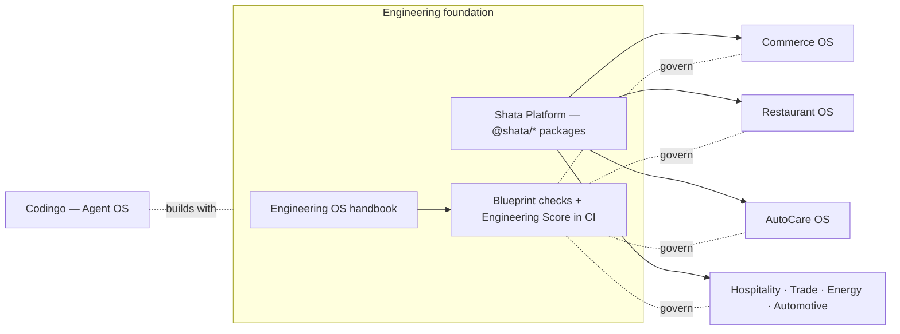

  

<h3 align="center">Building operating systems for real-world industries.</h3>

<em>AI-powered when useful. Fully human-operable by design.</em>

  <a href="#what-we-build">What we build</a> ·
  <a href="#how-we-engineer">How we engineer</a> ·
  <a href="#open-source">Open source</a> ·
  <a href="#contact">Contact</a>

---

Shata Solutions is a product-engineering company. We build vertical operating
systems — complete, opinionated software platforms for running a real business in a
specific industry — on one shared engineering foundation.

Three commitments run through everything:

1. **AI is optional, never load-bearing.** Every system has a complete manual
   *Human Mode*; AI features assist, they don't gate operations.
2. **Offline-first where the business needs it.** Point-of-sale and floor operations
   keep working when the connection doesn't.
3. **Measurable engineering discipline.** Every repository is held to a published
   blueprint and scored by an open-source checker — the same one linked below.

## What we build

Most product repositories are private while in active development; they are listed
here for breadth, not linkable. Maturity labels follow our shared vocabulary
(*Concept → Foundation → In development → Pilot-ready → Production*) and mirror each
repository's own status documentation.

| System | Industry | What it is | Status |
| --- | --- | --- | --- |
| **Codingo** | Software engineering | Independent Agent Operating System — models propose; a deterministic control plane decides, gates, executes, and rolls back | In development |
| **AutoCare OS** | Auto service centers | Workshop operating system — jobs, protection studio, offline PWA, verified backup/restore | Pilot-ready |
| **Commerce OS** | Retail / supermarkets | Register/POS, catalog, pricing, promotions, inventory, purchasing, finance, offline sync | In development |
| **Restaurant OS** | Restaurants | Orders, kitchen flow, and operations for food service | In development |
| **Hospitality OS** | Hotels | Reservations engine and front-desk operations | In development |
| **Trade OS** | Import / export | Trade documents, filings, costs, and ledger workflows | In development |
| **Energy OS** | Fuel & energy retail | Station and energy-retail operations | In development |
| **Automotive Dealer OS** | Used-car dealerships | B2B dealership operating system, Egypt-first | Foundation (docs-only) |
| **Shata Platform** | Shared core | Versioned `@shata/*` packages and cross-product contracts (accounting, offline sync) | In development |

## How we engineer

Our account-wide Engineering OS — a 24-chapter handbook of standards (repository
blueprint, git standards, AI-assisted engineering policy, offline-first standard,
financial-engineering standard with integer-money rules, AI/Human operation
standard) — governs every repository. Two things about it are unusual:

- **It is mechanically enforced.** A zero-dependency checker validates each repo
  against the blueprint and computes a heuristic Engineering Score in CI — a floor,
  not a certification. The tool is public: [`engineering-os-tools`](https://github.com/shatasolutions/engineering-os-tools).
- **It is honest by rule.** Status claims in any repo must match implementation
  truth; prototypes are labeled as prototypes. The same rule applies to this page.

Every vertical ships with **AI Mode and Human Mode** as peers, runs **cloud,
local-edge, or offline** where the domain demands it, and handles money in
**integer minor units** end to end.

## Open source

| Project | What it does |
| --- | --- |
| [`engineering-os-tools`](https://github.com/shatasolutions/engineering-os-tools) | Zero-dependency repository blueprint checker + engineering-score tool, with matching reusable GitHub Actions workflows. MIT. `v1` line, tagged releases. |

More of the foundation becomes public as it stabilizes.

## Contact

- **Email:** [info@shatasolutions.com](mailto:info@shatasolutions.com)
- **Partnerships, pilots, and engineering roles:** same address, subject-prefixed
  (`[Partnership]`, `[Pilot]`, `[Careers]`).

Everything on this page is backed by repository evidence or explicitly labeled
as in development. No production claims are made without a system in production.
Page verified 2026-08-08.
